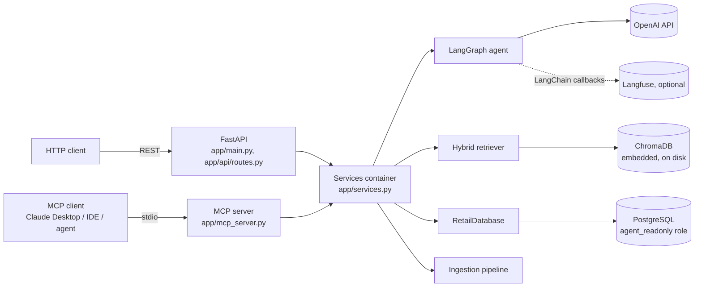
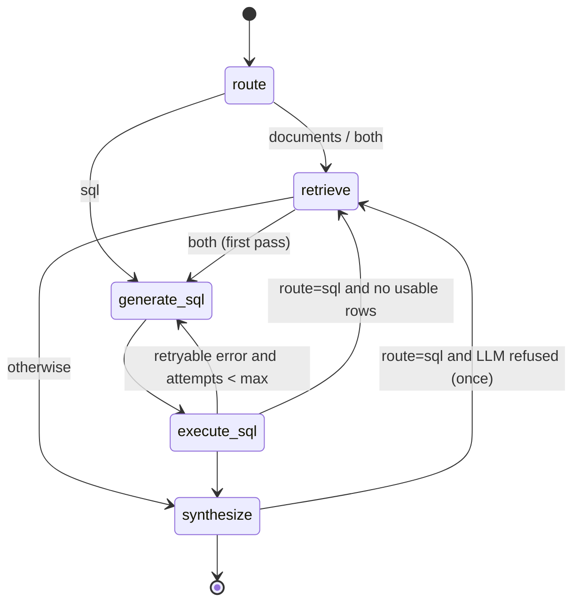
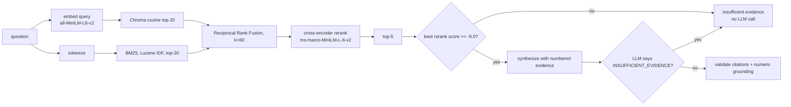
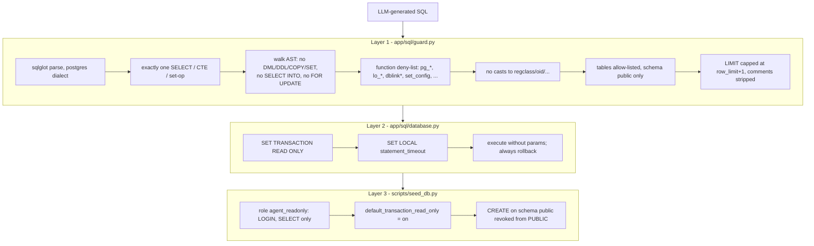
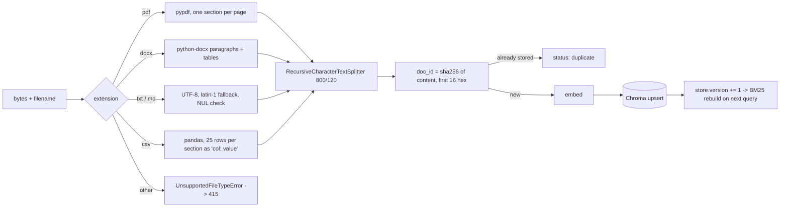
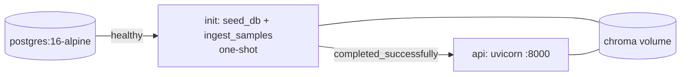

# Architecture

## System context

`app/services.py` is the composition root. It wires settings into concrete components exactly once. The API, the MCP server and the tests all build their dependencies there, and the tests swap in fakes: `FakeLLM`, `FakeDatabase`, `HashingEmbedder` and `OverlapReranker` in `tests/conftest.py`.

## Agent graph

`AgentState` (`app/agent/graph.py`) is a `TypedDict`. `warnings` and `steps` use `Annotated[list, operator.add]` reducers, so every node appends rather than overwrites. Nodes never raise domain errors: they convert them into state (`sql_error`, `warnings`), and `synthesize` decides how to degrade.

## Retrieval pipeline

Refusal is two-stage:
1. **Stage 1: a cheap evidence gate.** It is calibrated for recall and rejects clearly irrelevant questions without calling the LLM.
2. **Stage 2: the LLM.** It is instructed to return `INSUFFICIENT_EVIDENCE` when the evidence does not answer the question. On the 34-question benchmark it refused all 4 unanswerable questions in 3 of 3 runs, even though the gate passed 3 of them.

## SQL safety layers

Each layer assumes the one before it has failed. The integration tests check layer 3 on its own by connecting as the role directly and attempting a `DELETE` and a `CREATE TABLE` (`tests/integration/test_postgres.py`).

## Ingestion

## Deployment (Docker Compose)

The image bakes in both Hugging Face models at build time, so containers start offline. `init` and `api` share the Chroma volume.
